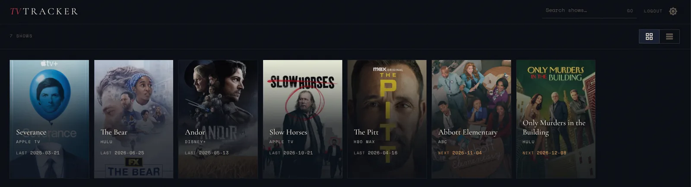
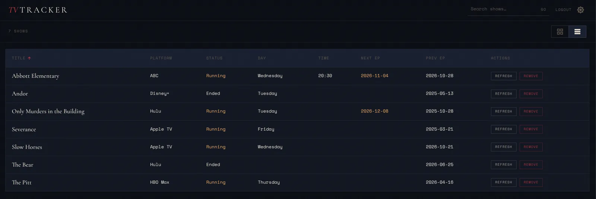

# TV Tracker

Track the TV shows you follow and see when the next episode airs. Search any show on TVMaze, add it to your list, and see the next and previous episode dates at a glance.

**Live demo: [tvtracker.labnerd.net](https://tvtracker.labnerd.net/)**. Click **Try the demo** on the landing page to explore without signing up. It creates a throwaway account pre-loaded with a few shows.




## Features

- Search TVMaze and add shows in one click
- Next or last episode date for every show, with per-show refresh
- Card grid or sortable table view
- Light and dark themes ("Broadcast Noir")
- Email/password accounts, plus a one-click demo mode

## Stack

| Layer | Tech |
|---|---|
| API | [Hono](https://hono.dev) on Cloudflare Workers, Zod validation |
| Database | Cloudflare D1 (SQLite) via Drizzle ORM |
| UI | React 19, React Router 7, MUI v7 |
| API client | Hono RPC client, with request and response types inferred from the API's `AppType` |
| Auth | HttpOnly cookies: 15-minute JWT access token plus a rotating refresh token; bcrypt passwords |
| Data source | [TVMaze public API](https://www.tvmaze.com/api) |
| Tooling | TypeScript, pnpm workspaces, Vitest, ESLint, Husky |

## Design notes

- **One Worker serves everything.** The Worker runs the API under `/api/*` and serves the built UI as static assets, with a single-page-app fallback so client routes survive a refresh. `run_worker_first` in `wrangler.jsonc` keeps API and health requests out of that fallback.
- **Cookie auth, no tokens in JavaScript.** The access and refresh tokens are `HttpOnly` cookies. The refresh token is a random value; only its SHA-256 hash is stored, and it is rotated on every refresh. On a 401 the UI refreshes once and retries.
- **Outbound requests are bounded.** TVMaze calls have timeouts and response size caps, and episode links are only followed if they point at `api.tvmaze.com`.
- **Slow work happens after the response.** Episode dates are resolved with `ctx.waitUntil`, so adding a show returns immediately.
- **Demo mode is built to be disposable.** `POST /api/auth/demo` creates a user on the reserved `demo.invalid` domain with an unusable password and a seeded show list, capped at 200 live demo users. An hourly cron deletes demo users older than 24 hours (their shows cascade-delete), and registration rejects the reserved domain so a real account can never be swept up.

## Local development

Requires Node 22+ (Wrangler's minimum) and pnpm.

```bash
pnpm install

# Local secrets (gitignored). ENVIRONMENT=development is needed so auth cookies work over http.
printf 'JWT_SECRET=%s\nENVIRONMENT=development\n' "$(openssl rand -base64 32)" > .dev.vars

pnpm exec wrangler d1 migrations apply tv-tracker --local

pnpm dev                                           # builds API and UI, then http://localhost:8787
```

`pnpm dev` does a full build before starting Wrangler, so restart it to pick up code changes.

## Deploying to Cloudflare

```bash
pnpm exec wrangler d1 create tv-tracker            # put the returned database_id in wrangler.jsonc
pnpm exec wrangler d1 migrations apply tv-tracker --remote
pnpm exec wrangler secret put JWT_SECRET           # openssl rand -base64 32
pnpm deploy                                        # builds both apps, then wrangler deploy
```

The cron trigger for demo cleanup is declared in `wrangler.jsonc` and is registered on deploy.

## Commands

Run from the repo root.

```bash
pnpm dev                 # build API and UI, run wrangler dev on :8787
pnpm build               # build API and UI
pnpm build:api           # tsc + tsc-alias (output: apps/api/dist/api/src/)
pnpm build:ui
pnpm deploy              # build + wrangler deploy
pnpm lint                # ESLint (API and UI)

pnpm --filter @tv-tracker/api test               # API tests
pnpm --filter @tv-tracker/ui test -- --run       # UI tests

pnpm --filter @tv-tracker/api db:generate        # generate a migration from schema changes
pnpm exec wrangler d1 migrations apply tv-tracker --local
```

## Project structure

```
apps/
  api/        Hono API (Cloudflare Worker)
    src/
      routes/           auth, user, admin handlers
      db/               Drizzle schema + query functions
      schemas/          Zod request schemas
      demo/             demo-mode constants and seed shows
      utils/            auth cookies, middleware, background jobs, env helpers
      tvmaze.ts         TVMaze API wrapper
    drizzle/            migration files (commit these)
    tests/
  ui/         React frontend (Vite)
    src/
      apis/             one file per API domain
      contexts/         Auth, Show, Alert, Theme providers
      pages/            route-level components
      components/       shared UI components
      utils/            theme, Hono client, request helpers
    tests/
  shared/     Shared TypeScript types (no build step)
wrangler.jsonc          Worker config: D1 binding, static assets, cron
```

## API overview

```
POST   /api/auth/register
POST   /api/auth/login
POST   /api/auth/demo             # create and sign in a throwaway demo user
POST   /api/auth/refresh
POST   /api/auth/logout
DELETE /api/auth/deleteUser

GET    /api/user/profile
GET    /api/user/tvshows
GET    /api/user/tvshow/:id
POST   /api/user/tvshow           # add by full TVMaze JSON body
POST   /api/user/tvshow/:id       # add by TVMaze show ID
PATCH  /api/user/tvshow/:id       # refresh from TVMaze
DELETE /api/user/tvshow/:id

GET    /api/admin/users           # admin role only
GET    /health
```

Protected routes read the `accessToken` cookie; there is no `Authorization` header.

## Notes

- Migration files in `apps/api/drizzle/` must be committed. Apply them with `wrangler d1 migrations apply`.
- There is no rate limiting yet. Demo sign-ups are bounded by the user cap and cleanup, not per-IP limits.
- Show and episode data comes from TVMaze and is not owned by this project.
